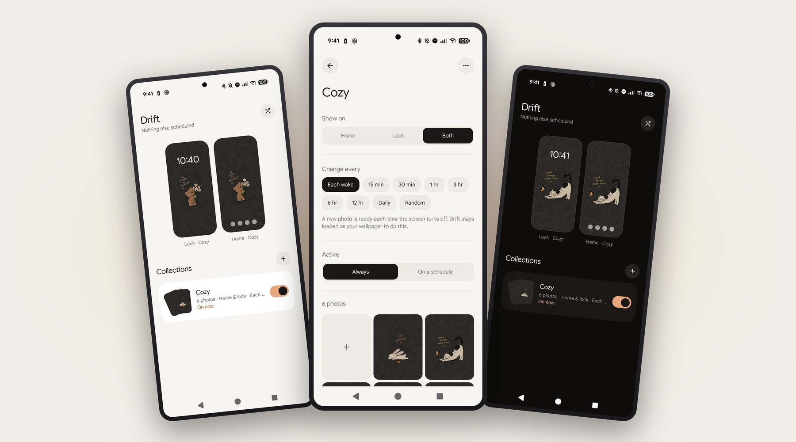
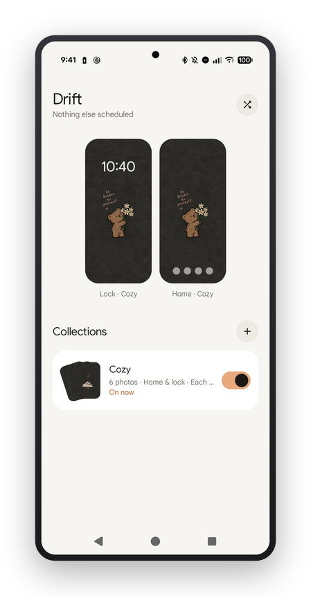
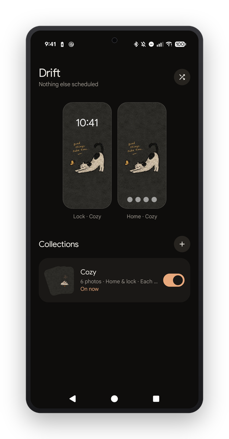
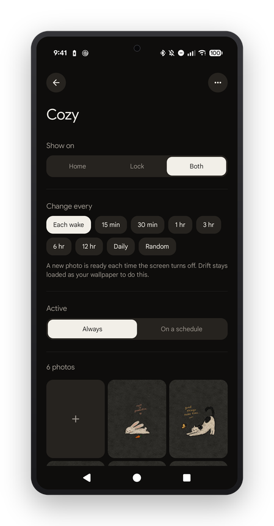
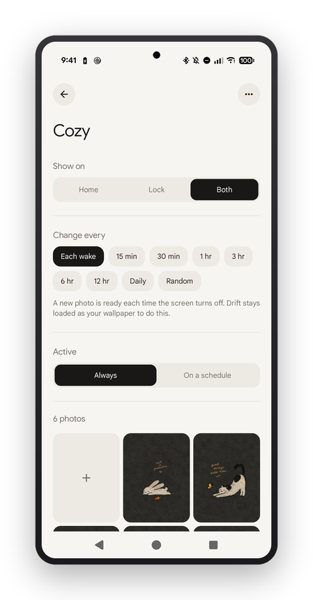
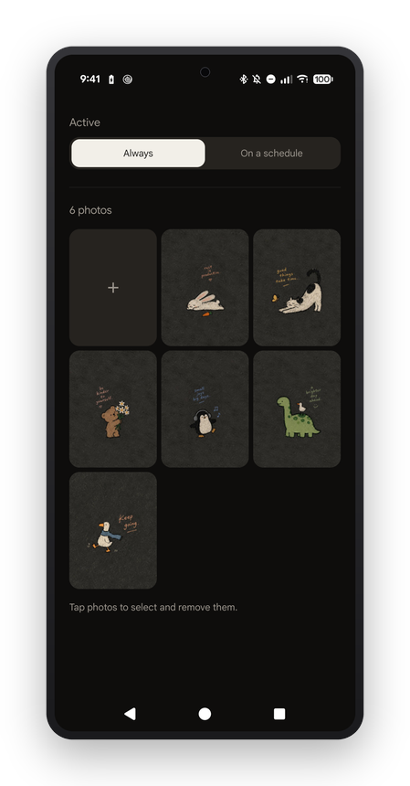
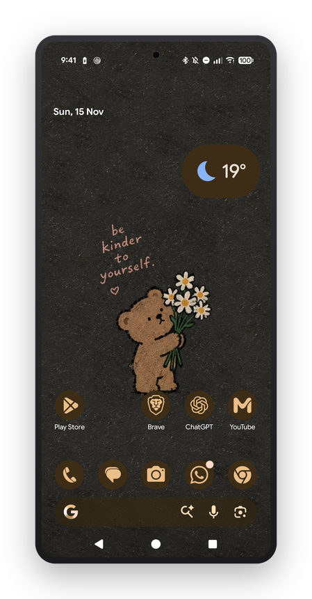
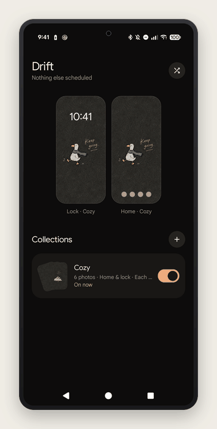

# Drift



**A minimal wallpaper rotator for Android that quietly changes your home and lock screen through the day.**

Pick photos, group them into collections, and choose when each one rotates. In its default timed mode Drift has no background process between changes.

## Screenshots

| Light | Dark |
|:---:|:---:|
|  |  |
|  |  |
|  |  |

A collection's wallpaper on the launcher, and tapping a preview on the home screen to shuffle it:

 

## What it does

- **Collections** of photos from your gallery, chosen with the system photo picker. Drift needs no storage permission.
- **Home, lock, or both**, set per collection.
- **Rotation interval**: 15 min, 30 min, 1, 3, 6 or 12 hours, or daily. Photos are shuffled without repeats until each one has been shown.
- **Random**: a different gap every time, from 30 minutes to 4 hours.
- **Each wake**: a new photo is ready every time the screen turns off. This needs Drift set as your live wallpaper (one-time setup from the editor).
- **Schedules**: limit a collection to certain days and a time range, which can cross midnight. A scheduled collection takes over from always-on ones while its schedule is active.

## How it stays light

- **No resident process in timed mode.** One inexact `AlarmManager.setWindow` alarm (10-minute window) wakes a receiver. The receiver sets whatever is due, books the next alarm, and exits. It skips the 60-second polling loop, foreground service and WorkManager that apps like this often use.
- **Each wake is the exception.** Hearing the screen turn off needs a receiver that is always registered, so Drift stays loaded as your live wallpaper while that mode is in use. It draws only when the photo changes. Static timed mode (any other interval) remains the lightest.
- **Wallpapers are decoded once, at screen size.** `ImageDecoder` applies EXIF rotation, then Drift centre-crops and hands the system a compact JPEG.
- **Two permissions, both granted automatically:** `SET_WALLPAPER` and `RECEIVE_BOOT_COMPLETED`. It has no network access, notifications or exact-alarm permission.
- **No libraries beyond Compose Material 3 and Activity.** State is one JSON file, read with Android's built-in `org.json`. The release APK is about 2.3 MB.

## Measured on a Pixel 9 (Android 17)

- Release APK: 2.3 MB. Cold start: about 370 ms.
- One background change: 1 wake-up alarm, about 0.7 s of wake lock and about 0.5 s of CPU, after which Android freezes the process.
- Verified with the app process killed and the screen off:
  - an interval rotation happened;
  - a schedule edge handed the lock screen back from a scheduled collection to the always-on one;
  - the receiver cold-started from the alarm.
- Photos with EXIF rotation and landscape photos come out upright and centre-cropped.

Debug builds add a "1 min" interval so background behaviour can be checked quickly. Release builds don't show it.

## Battery

Benchmarks: see below.

## Known limits

- Changes land within about 10 minutes of the target time. Exact timing would need the "Alarms & reminders" permission, which Drift deliberately doesn't ask for. In Doze, Android may defer changes further, until the phone wakes.
- "Each wake" changes the photo when the screen turns off, not at the moment of unlock, and requires Drift to be the live wallpaper for the screens it targets.
- Android caps persisted photo grants at 512 per app. Drift releases a grant when a photo is removed from every collection.
- Force-stopping the app cancels its alarm until the app is opened again. This is standard Android behaviour.

## Building

Requirements: JDK 17 or newer (Android Studio's JBR works) and Android SDK 37.

```sh
./gradlew :app:testDebugUnitTest   # schedule logic tests
./gradlew :app:assembleDebug
./gradlew :app:assembleRelease     # signed if keystore/keystore.properties exists
```

Release signing reads `keystore/keystore.properties` (gitignored) with `storeFile`, `storePassword`, `keyAlias` and `keyPassword`.

## Code map

| File | Role |
|---|---|
| `Model.kt` | Collections, schedules, active-collection rules, JSON store |
| `Engine.kt` | Decides what's due, sets wallpapers, books the next alarm; boot/time receiver |
| `DriftWallpaper.kt` | Optional live wallpaper: draws the current photo and rotates "Each wake" collections on screen-off |
| `Wording.kt` | Interval, target, day and schedule labels shared by the list and editor |
| `MainActivity.kt` | Activity, navigation, photo-grant bookkeeping |
| `Home.kt` / `Editor.kt` | The two screens |
| `Ui.kt` | Theme, icons, shared controls, thumbnail loader |
